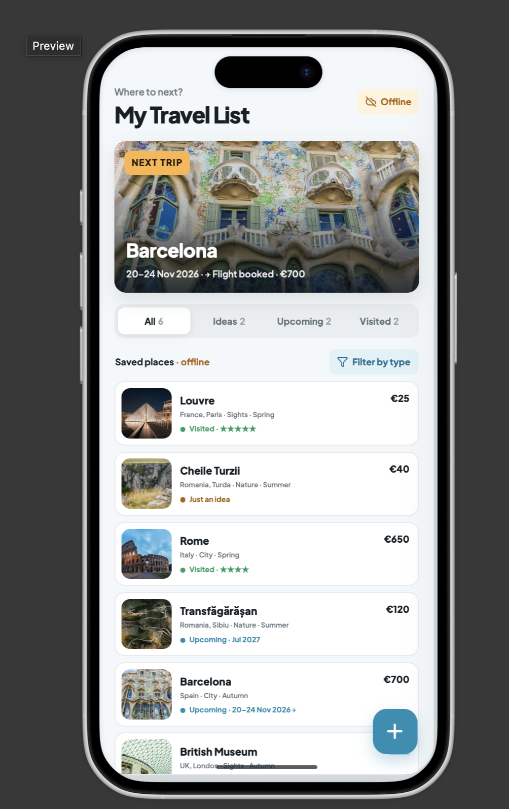
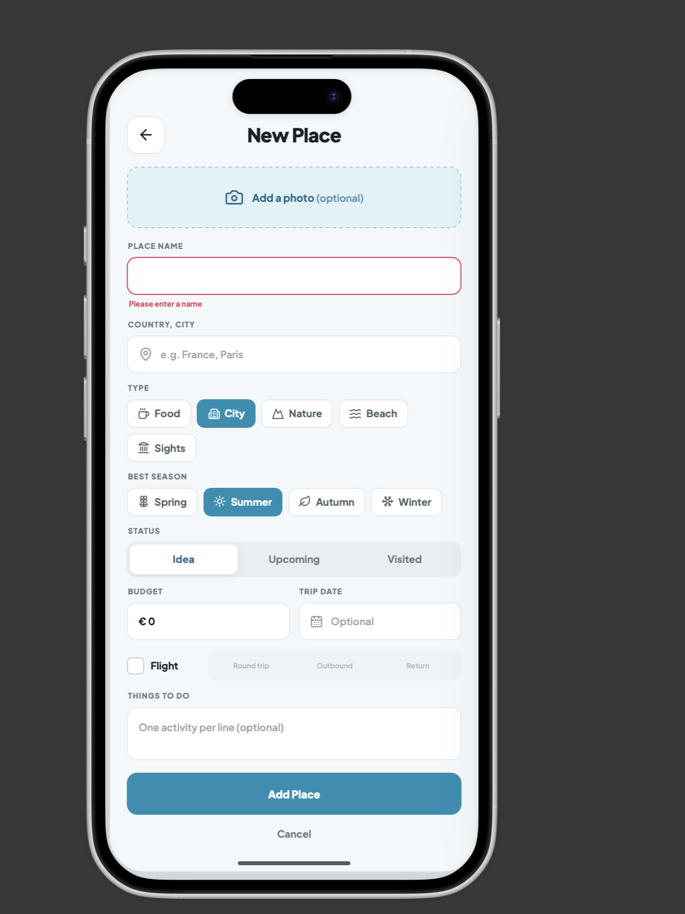
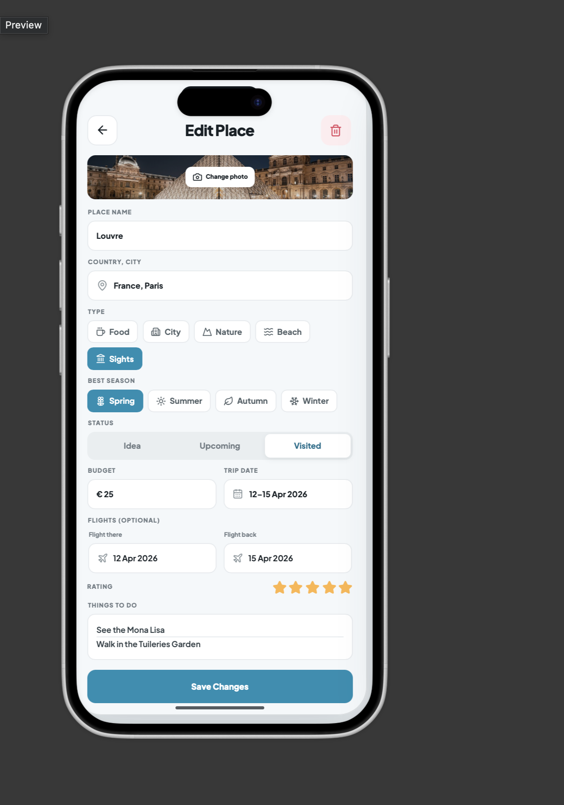
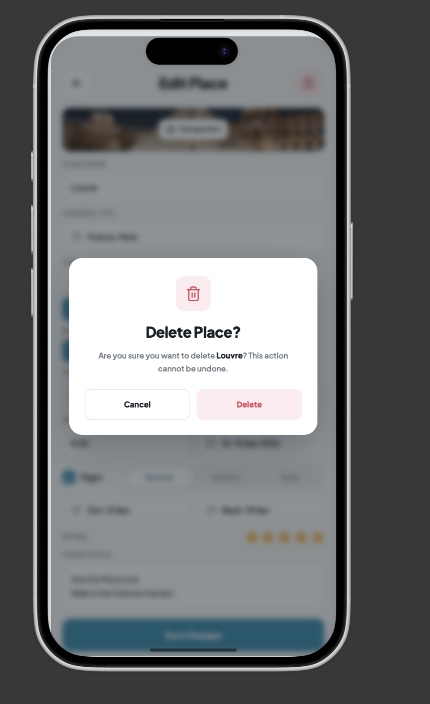

# TravelList – Places to Visit

## 1. Application Description

TravelList is a mobile application that helps users keep all the places they want to visit in one list.

As a user, I want to save cities, beaches, natural places, museums and restaurants that I hear about, both in my country and abroad, so I don't forget them.

The application should allow me to add new places, view my saved places, change their details and remove places I am no longer interested in.

For each place I want to know if it is just an idea, an upcoming trip or a trip I already made, if I have a flight, how much money I need and what I want to do there.

The application should allow me to see and manage my places without an internet connection. Changes made offline should be saved and synchronized when the connection becomes available again.

The application should have a simple and user-friendly interface.

## 2. Place Details

The main entity of the application is a **Place**.

Each place contains the following information:

| Field | Description |
|---|---|
| ID | A unique number automatically given to each place. It is not shown to the user. |
| Name | The name of the place, such as Louvre or Cheile Turzii. It is required. |
| Location | The country and the city, such as France, Paris. It is required. |
| Type | The kind of place, selected from a predefined list. |
| Best Season | The season when the weather is good for visiting: Spring, Summer, Autumn or Winter. |
| Budget | The estimated cost of the trip, in euro. It must be 0 or more. |
| Status | Idea, Upcoming or Visited. |
| Trip Date | When the trip takes place or took place. It is optional for ideas. |
| Flight There | Optional checkbox, checked if the user has a flight to the place. |
| Flight Back | Optional checkbox, checked if the user has a flight back home. |
| Rating | A grade from 1 to 5. Only used for visited places. |
| Things to Do | Optional list of activities the user wants to do there, one per line. |
| Photo | An optional picture of the place, chosen from the phone gallery. |

### Available Types

Users can choose from the following types:

- Food (restaurants, cafés)
- City (city breaks)
- Nature (mountains, parks, trails)
- Beach (sea, lakes)
- Sights (museums, castles, monuments)

### Available Statuses

- **Idea:** the user only thinks about visiting the place.
- **Upcoming:** the trip is planned.
- **Visited:** the trip is in the past and the user can give a rating.

## 3. Main Functionalities (CRUD)

### Create – Add a Place

The user can add a new place by pressing the **+** button on the main screen.

The user enters the name and the location, selects the type, the best season and the status, and can add the budget, the trip date, a photo and the things to do, and can optionally check "Flight there" and/or "Flight back".

After selecting **Add Place**, the new place is added to the list.

The application displays an error message if the name or the location is missing or if the budget is negative.

### Read – View Places

The main screen displays the next upcoming trip at the top and the list of all saved places below it.

The user can see all places or only the ideas, the upcoming trips or the visited places. The list can also be filtered by type.

Each place displays its photo, name, location, type, best season, budget and status. Upcoming trips also show the date and if the flights are booked, and visited places show the rating.

### Update – Edit a Place

The user can edit a place by selecting it from the list.

The application displays the current information, allowing the user to change any detail, for example the status after the trip, the flight checkboxes or the rating.

After selecting **Save Changes**, the updated information is displayed in the list.

### Delete – Remove a Place

The user can remove a place they are no longer interested in by pressing the delete button on the edit screen.

Before deleting, the application displays a confirmation message with the name of the place, to prevent accidental deletion.

After confirmation, the place is removed from the list and the deletion is saved.

## 4. Data Storage and Synchronization

The application stores the places in a local database on the user's device and in a database on a remote server.

| Operation | Local Storage | Server |
|---|---|---|
| Create | Save the new place locally. | Add the place and give it an ID when an internet connection is available. |
| Read | Display the places saved on the device. | Retrieve the latest places when online. |
| Update | Save the changes to an existing place. | Update the place when an internet connection is available. |
| Delete | Remove the place from the list and save the pending deletion. | Delete the place, using only its ID, when an internet connection is available. |

The application keeps track of pending changes and deletions, so deleted places do not appear again after synchronization.

## 5. Offline Functionality

The application allows users to view, add, edit and delete places without an internet connection.

### Create – Offline

Users can add a new place while offline. The place is saved locally and appears immediately in the list.

The new place is marked as **Waiting to Sync** until it is sent to the server when the connection returns.

### Read – Offline

Users can view the places saved on their device, with all their details, even without an internet connection.

The application displays an offline message to show that the server is not available and the list may not include the latest changes.

### Update – Offline

Users can change a place while offline. The changes are saved locally and displayed immediately in the list.

The place is marked as **Waiting to Sync**. The pending change is kept even if the application is closed, and it is sent to the server when the connection returns.

### Delete – Offline

Users can delete a place while offline. After confirmation, the place is removed from the list and the deletion is saved locally.

When the connection returns, the deletion is sent to the server.

## 6. Application Mockups

The application has a simple interface with the following screens:

### My Travel List

The main screen displays the next trip, the tabs All, Ideas, Upcoming and Visited, the filter by type and the list of places.

It also shows when the server is offline and includes a **+** button for adding a place.

### Add Place

This screen allows users to enter all the details of a new place. It shows an error message if the name is missing.

### Edit Place

This screen displays the existing information of a place and allows users to change it.

### Delete Confirmation

Before removing a place, the application displays a confirmation message with its name. The user can confirm the deletion or cancel it.

